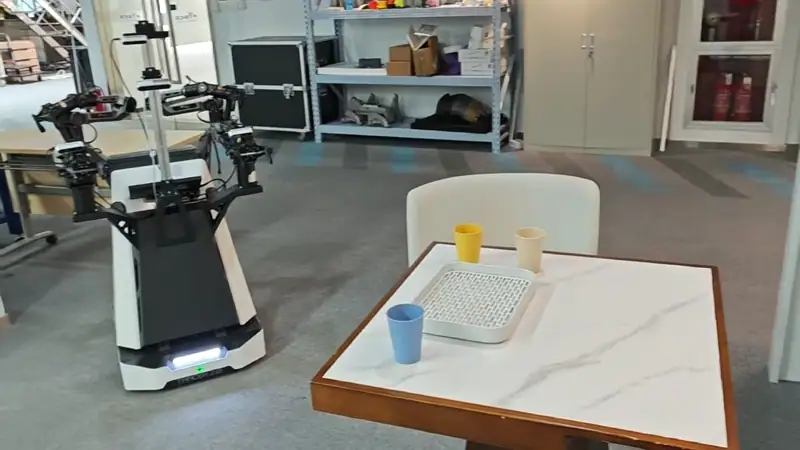
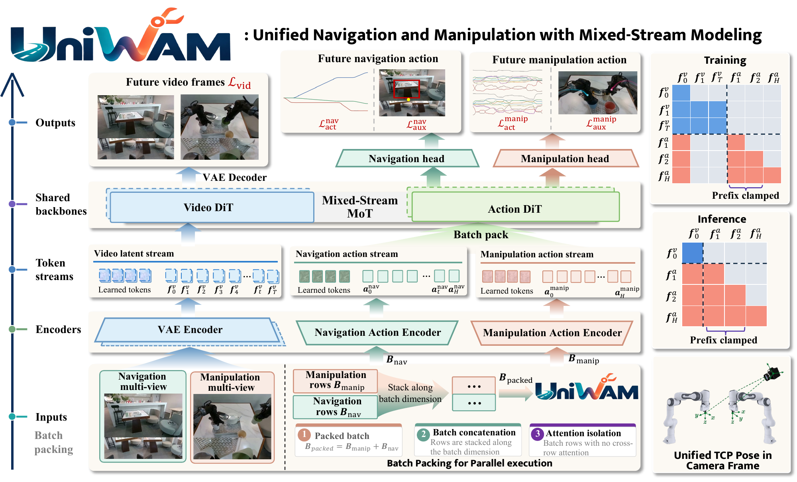
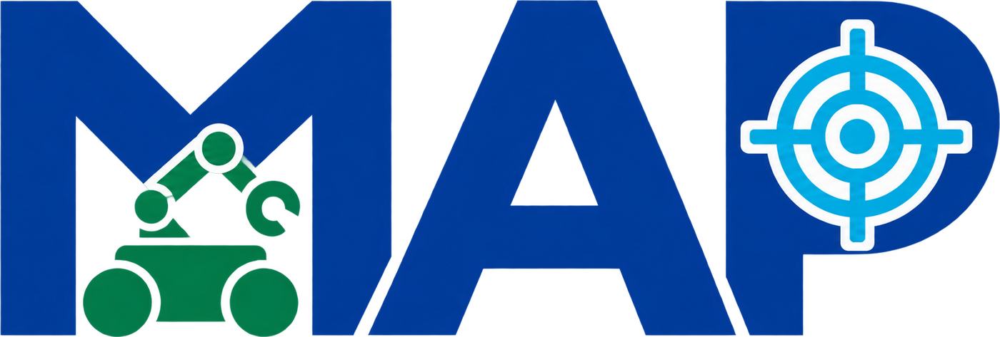
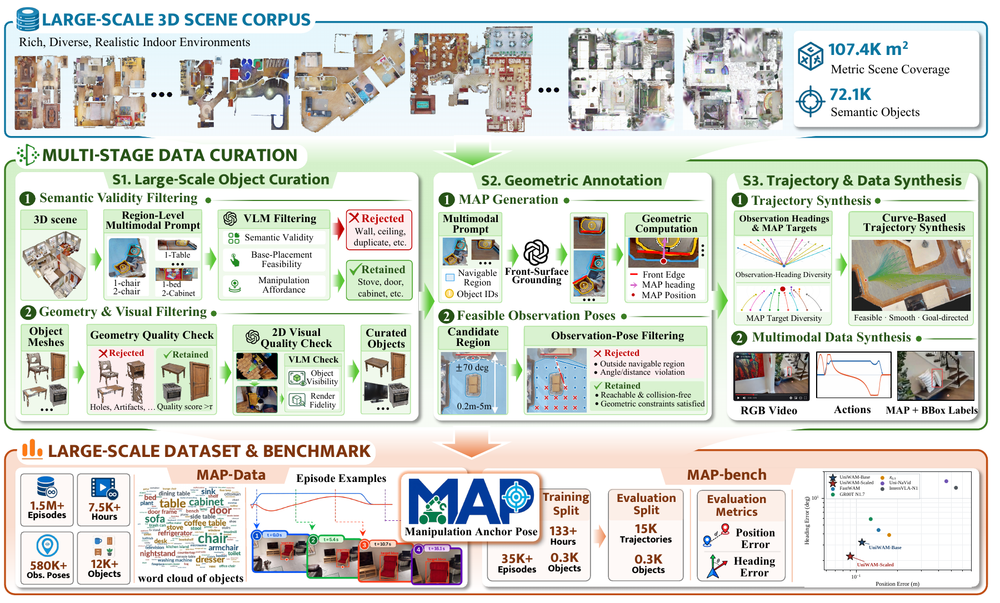
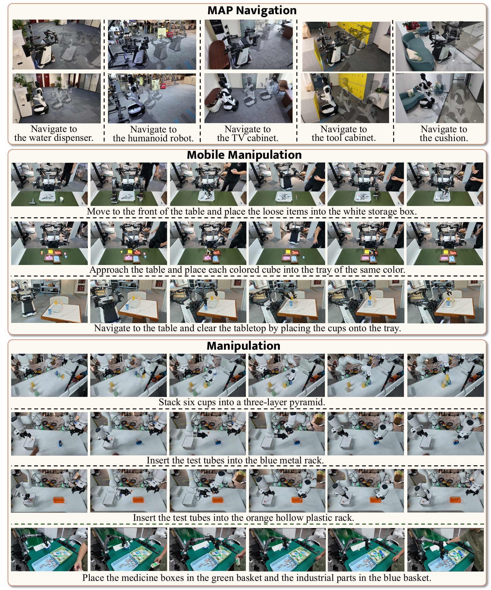

<h1 align="center">Unified Mobile Manipulation via Mixed-Stream World-Action Modeling and Manipulation Anchor Pose Supervision</h1>

<p align="center">
  Wei Xue<sup>*</sup>, Keliang Liu<sup>*</sup>, Mingzhang Cui, Jinhua Xie, Jinjie Wei, Jianan Hou, Jingcheng Lu,<br />
  Lintao Wang, Kaixiang Qiu, Yizhou Liu, Xinghai Ye, Jinghang Han, Mingcheng Li, Jie Gu,<br />
  Shunli Wang, Lihua Zhang<sup>§</sup>, Dingkang Yang<sup>†,§</sup>
</p>

<p align="center">
  Physical Superintelligence Lab, Fysics AI<br />
  College of Intelligent Robotics and Advanced Manufacturing, Fudan University
</p>

<p align="center"><sub><sup>*</sup> Equal contribution; order decided by a coin flip. &nbsp; <sup>†</sup> Project lead. &nbsp; <sup>§</sup> Corresponding author.</sub></p>

We introduce **UniWAM**, a unified world-action model that shares a backbone across navigation and manipulation, and **Manipulation Anchor Pose (MAP)**, which teaches robots where to stop and how to orient before interacting with objects. Across **MAP-Bench and 24 real-robot tasks on four embodiments**, UniWAM achieves leading navigation and mobile manipulation results among the compared methods. **UniWAM-Scaled reaches 80.0% mobile manipulation success**.

<p align="center">
  <a href="https://fysics-ai.github.io/uniwam.github.io/assets/demo-manip.mp4">
    
  </a>
  <br /><em>Mobile manipulation on a real robot · 2× preview · <a href="https://fysics-ai.github.io/uniwam.github.io/assets/demo-manip.mp4">Watch the full video</a></em>
  <br /><sub>Forward motions use model inference; reverse movements are teleoperated.</sub>
</p>

## Overview

<a id="uniwam"></a>

<h3></h3>

Navigation and manipulation have separate camera inputs, action encoders, output heads, and learnable stream tokens over **shared video and action transformers**. Independent stream sampling supports navigation-only, manipulation-only, and joint execution. The model predicts actions together with image-plane targets, using causal action attention and a committed action prefix to continue ongoing motion.

<p align="center">
  
  <br /><em>The full UniWAM architecture. Stream-specific observations and action interfaces share a common world-action backbone.</em>
</p>

<a id="map"></a>

<h3></h3>

A **Manipulation Anchor Pose (MAP)** is the base position and heading from which a robot can begin manipulation. We build **MAP-Data** with automated scene annotation and trajectory construction, then use **MAP-Bench** to evaluate instruction-conditioned navigation to these poses in HM3D. The benchmark contains **35,454 training trajectories** (7,184,098 RGB frames at 15 Hz) and **15,000 evaluation trajectories** across three distance levels; the full MAP-Data collection contains **over 1.5 million trajectories and 7,500 hours**, while this release provides a compact subset generated from HM3D scenes. MAP-Bench uses one forward RGB view and one navigation expert because it evaluates navigation only. The public [MAP-Data](https://huggingface.co/datasets/Fysics-AI/MAP-Data), [MAP-Bench](https://huggingface.co/datasets/Fysics-AI/MAP-Bench), released traces, and evaluation scripts support direct reproduction.

<p align="center">
  
  <br /><em>From 3D scenes and manipulation-ready poses to navigation supervision and evaluation.</em>
</p>

### End-effector trajectory supervision

The technical report uses image-plane end-effector tracks as auxiliary targets for UniWAM's manipulation stream. The [end-effector point-tracking pipeline](robot-eef-point-tracking/README.md) in this repository generates these per-frame labels from calibrated robot poses and the main manipulation camera: geometry projects each arm's end-effector point into the image, and a DINOv2 appearance check labels visibility and occlusion. The resulting 2D tracks and quality masks are used when preparing manipulation training data.

## Release checklist

- <span style="color:#2ea043;font-weight:700">✓</span> [Paper](https://arxiv.org/abs/2609.39388) and [project website](https://fysics-ai.github.io/uniwam.github.io/)
- <span style="color:#2ea043;font-weight:700">✓</span> [UniWAM-Base and UniWAM-Scaled checkpoints for MAP-Bench](#checkpoints)
- <span style="color:#2ea043;font-weight:700">✓</span> [UniWAM architecture, training and inference code](training/README.md)
- <span style="color:#2ea043;font-weight:700">✓</span> [End-effector track label generation](robot-eef-point-tracking/README.md) for manipulation supervision
- <span style="color:#2ea043;font-weight:700">✓</span> [MAP-Bench training and evaluation data](https://huggingface.co/datasets/Fysics-AI/MAP-Bench) and [evaluation scripts](#evaluation)
- <span style="color:#2ea043;font-weight:700">✓</span> [Baseline comparisons and evaluation trajectories](#results)
- <span style="color:#2ea043;font-weight:700">✓</span> [MAP-Data: an HM3D-derived subset](#map)

**Contents:** [Overview](#overview) · [Results](#results) · [Installation & downloads](#installation) · [Training & evaluation](#usage) · [Citation](#citation)

## Results

### MAP-Bench results

MAP-Bench evaluates navigation at three distance levels:

| Level | Reference path length | Evaluation trajectories |
| :--- | :--- | ---: |
| **Short** | < 1.5 m | 2,110 |
| **Medium** | 1.5 m ≤ length < 3.5 m | 10,014 |
| **Long** | ≥ 3.5 m | 2,876 |
| **Total** | | **15,000** |

MAP position / heading error ↓, computed from the released evaluation traces:

| Method | Short (cm / °) | Medium (cm / °) | Long (cm / °) | Overall (cm / °) |
| :--- | ---: | ---: | ---: | ---: |
| [GR00T N1.7](https://github.com/NVIDIA/Isaac-GR00T) | 9.48 / 5.66 | 10.81 / 5.42 | 22.04 / 7.46 | 14.11 / 6.18 |
| [π₀.₅](https://github.com/Physical-Intelligence/openpi) | 7.98 / 3.26 | 9.85 / 3.51 | 50.84 / 5.55 | 22.89 / 4.11 |
| [FastWAM](https://github.com/yuantianyuan01/FastWAM) | 9.24 / 3.44 | 10.96 / 3.95 | 31.10 / 6.66 | 17.10 / 4.68 |
| UniWAM-Base | 7.71 / 2.37 | 8.85 / 3.06 | 20.97 / 4.29 | 12.51 / 3.24 |
| **UniWAM-Scaled** | **7.48 / 1.82** | **7.86 / 2.08** | **14.24 / 3.01** | **9.86 / 2.30** |

Overall is the macro-average of the three difficulty levels. We release **15,000 rollout trajectories per model** for three baselines (GR00T N1.7, π₀.₅, and FastWAM) and UniWAM-Base/Scaled, totaling **75,000 trajectories**. [Recompute the results](#evaluation) from these traces or evaluate a policy in Habitat.

### Real-robot results

The real-robot experiments cover 24 tasks across four embodiments. The figure shows representative navigation, mobile-manipulation, and manipulation executions corresponding to the results reported in the paper.

<p align="center">
  
  <br /><em>Real-robot executions spanning navigation, mobile manipulation, and dexterous manipulation.</em>
</p>


<a id="installation"></a>

## Installation and downloads

Create a workspace and run the following commands from `uniwam-workspace/UniWAM`. Code, weights, and data use relative locations within this workspace.

```bash
mkdir -p uniwam-workspace
cd uniwam-workspace
git clone https://github.com/Fysics-AI/UniWAM.git
cd UniWAM
```

### Model environment

```bash
conda create -n uniwam-policy python=3.10 -y
conda activate uniwam-policy
python -m pip install torch==2.7.0 torchvision==0.22.0 --index-url https://download.pytorch.org/whl/cu128
python -m pip install -r requirements-policy.txt
# Include this for model training:
python -m pip install -r training/requirements-training.txt
```

### Benchmark environment

Habitat evaluation runs in a separate environment and connects to the policy through WebSocket.

```bash
conda create -n uniwam-eval python=3.9 -y
conda activate uniwam-eval
conda install habitat-sim=0.3.3 withbullet headless -c conda-forge -c aihabitat
python -m pip install -r requirements.txt
python -c 'import habitat_sim'
```

<a id="checkpoints"></a>

### Checkpoints and data

| Model | MAP-Bench checkpoint |
| :--- | :--- |
| π₀.₅ · [GitHub](https://github.com/Physical-Intelligence/openpi) | [🤗 Checkpoint](https://huggingface.co/Fysics-AI/UniWAM/tree/main/baselines/pi05) |
| GR00T N1.7 · [GitHub](https://github.com/NVIDIA/Isaac-GR00T) | [🤗 Checkpoint](https://huggingface.co/Fysics-AI/UniWAM/tree/main/baselines/groot_n17) |
| **UniWAM-Base** | [🤗 Checkpoint](https://huggingface.co/Fysics-AI/UniWAM/tree/main/weights/base) |
| **UniWAM-Scaled** | [🤗 Checkpoint](https://huggingface.co/Fysics-AI/UniWAM/tree/main/weights/scaled) |

> **MAP-Bench checkpoints.** The Base and Scaled checkpoints above use a single navigation expert and one forward RGB view, because MAP-Bench evaluates navigation only. They predict base waypoints together with target-object boxes and image-plane MAP coordinates. The camera-frame mobile-manipulation [training and inference code](training/real_robot/README.md) is a separate path with its own action contract. Task-trained real-robot checkpoints are not included.

```bash
conda activate uniwam-policy
# UniWAM checkpoints, shared components, benchmark data, and baseline/UniWAM rollouts:
python scripts/download_assets.py --model all --benchmark --training --traces
# Baseline checkpoints:
python scripts/download_assets.py --baseline pi05
python scripts/download_assets.py --baseline groot_n17
```

The model package includes the **VAE, UMT5-XXL encoder, tokenizer, normalization, and text features** used in evaluation. Base and Scaled share these components. For camera-frame training, the pretrained video backbone comes from [Wan2.2-TI2V-5B](https://huggingface.co/Wan-AI/Wan2.2-TI2V-5B), following [FastWAM](https://github.com/yuantianyuan01/FastWAM); the separate [installation guide](training/real_robot/docs/INSTALLATION.md) covers that environment. [New instructions](docs/TEXT_FEATURES.md) use the same T5 encoder.

Download [HM3D v0.2 scenes](https://aihabitat.org/datasets/hm3d/) separately and place them under `../hm3d-v0.2/scenes_train_val`. See [setup details](docs/SETUP.md), [tested versions](environment.md), and [comparison models](docs/BASELINES.md) for the complete folder layout and additional options.

<a id="usage"></a>

## Training and evaluation

<a id="training"></a>

### Unified UniWAM training and inference

The camera-frame path independently samples navigation and manipulation streams with separate visual inputs and action heads over shared video/action DiTs. It uses a 20D bimanual state and a 26D manipulation action; its included navigation configuration is 3D, distinct from the MAP-Bench 9D navigation checkpoint above. It trains on your own LeRobot demonstrations with external model initialization and calibration. Task-trained mobile-manipulation checkpoints are not released.

```bash
cd training/real_robot
# Follow README.md to install dependencies, prepare data, and launch training.
```

[Real-robot training and inference](training/real_robot/README.md) documents the data layout, camera transforms, initialization, action masks, asynchronous cloud inference, and ROS 2 execution.

### MAP-Bench navigation training

MAP-Bench is a reproducible navigation-only setting. It uses one navigation expert, one forward RGB view, and 9D navigation outputs (base waypoints plus box/MAP auxiliary targets); no manipulation stream or real-robot data is needed. The released training split contains **35,454 trajectories**. The public Base preset initializes from Wan2.2, with FastWAM action-backbone interpolation. It is in `training/configs/task/uniwam_base_hm3d.yaml` and follows the report's benchmark budget (40,000 steps, AdamW with initial learning rate `1e-5`, cosine decay, bf16, and ten Euler inference steps).

```bash
conda activate uniwam-policy
python scripts/download_assets.py --vae --training
cd training
export UNIWAM_DATA_ROOT="$(realpath ../../MAP-Bench/training)"
export UNIWAM_TEXT_CACHE="$UNIWAM_DATA_ROOT/text_embeddings"
bash scripts/train.sh 16
```

See [MAP-Bench training details](training/NAVIGATION.md) for the portable relative data layout and smoke test. This configuration is separate from the camera-frame real-robot path above.

<a id="inference"></a>
<a id="evaluation"></a>

### MAP-Bench evaluation

MAP-Bench evaluation uses **15,000 held-out trajectories** and HM3D scenes downloaded separately from [Habitat](https://aihabitat.org/datasets/hm3d/). The Base and Scaled checkpoints in the model package are the navigation checkpoints used for this evaluation.

```bash
# Terminal 1: policy/model environment
conda activate uniwam-policy
python scripts/launch_uniwam.py --model base \
  --model-root ../UniWAM-weights --gpus 0 --ports 18144

# Terminal 2: Habitat benchmark environment
conda activate uniwam-eval
export HM3D_SCENE_ROOT="$(realpath ../hm3d-v0.2/scenes_train_val)"
python scripts/launch_external_eval.py \
  --data-root ../MAP-Bench --output-dir outputs/base \
  --policy-ports 18144 --habitat-gpus 1 --batch-size 32
```

Use `--model scaled` for Scaled. Both launchers accept `--dry-run`. The benchmark evaluator, metric aggregation, and all released baseline/UniWAM rollout traces are in the [code and MAP-Bench repositories](#checkpoints). To recompute the table from the released traces:

```bash
python scripts/verify_evaluation.py --data-root ../MAP-Bench
python scripts/compute_table4.py --data-root ../MAP-Bench
```

## Acknowledgments

**Our core training and inference code is built on [FastWAM](https://github.com/yuantianyuan01/FastWAM).** We thank its authors for open-sourcing the world-action modeling codebase.

We also thank the teams behind [Wan2.2](https://github.com/Wan-Video/Wan2.2), [DiffSynth-Studio](https://github.com/modelscope/DiffSynth-Studio), [OpenPI](https://github.com/Physical-Intelligence/openpi), [Isaac GR00T](https://github.com/NVIDIA/Isaac-GR00T), [Habitat-Sim](https://github.com/facebookresearch/habitat-sim), and [HM3D](https://aihabitat.org/datasets/hm3d/). Bundled components retain their attribution and license notices; see [third-party notices](THIRD_PARTY_NOTICES.md).

## License

Original UniWAM code in this repository is released under [Apache-2.0](LICENSE). The end-effector point-tracking folder retains its separate [MIT license](robot-eef-point-tracking/LICENSE). Model and dataset terms are described in their Hugging Face cards and [license notes](docs/LICENSES.md). HM3D, π₀.₅/Gemma, and other upstream assets retain their own terms.

## Citation

```bibtex
@article{xue2026uniwam,
  title   = {UniWAM Technical Report: Unified Mobile Manipulation via Mixed-Stream World-Action Modeling and Manipulation Anchor Pose Supervision},
  author  = {Wei Xue and Keliang Liu and Mingzhang Cui and Jinhua Xie and Jinjie Wei and Jianan Hou and Jingcheng Lu and Lintao Wang and Kaixiang Qiu and Yizhou Liu and Xinghai Ye and Jinghang Han and Mingcheng Li and Jie Gu and Shunli Wang and Lihua Zhang and Dingkang Yang},
  journal = {arXiv preprint arXiv:2609.39388},
  year    = {2026},
  url     = {https://arxiv.org/abs/2609.39388}
}
```
